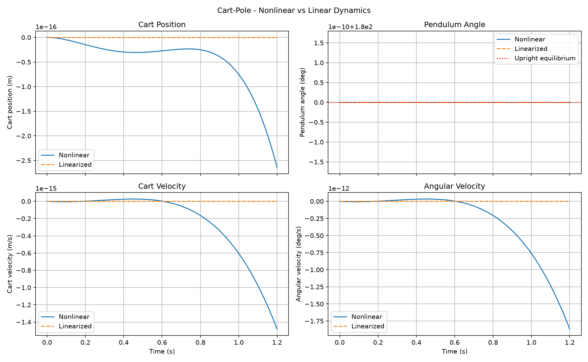
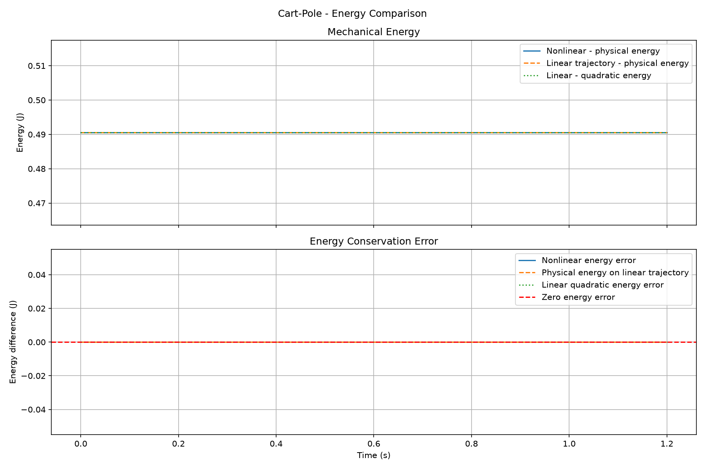
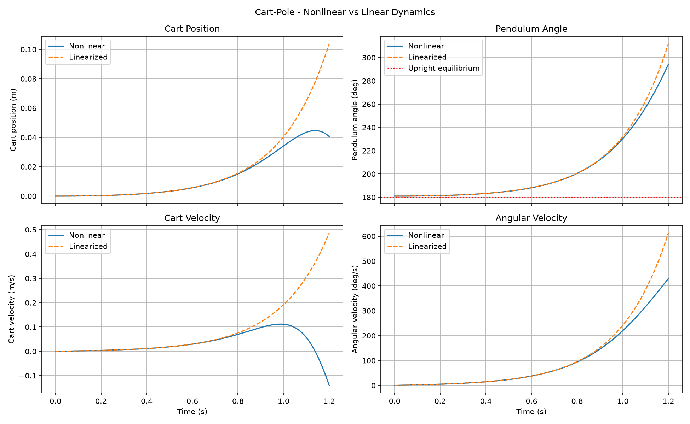
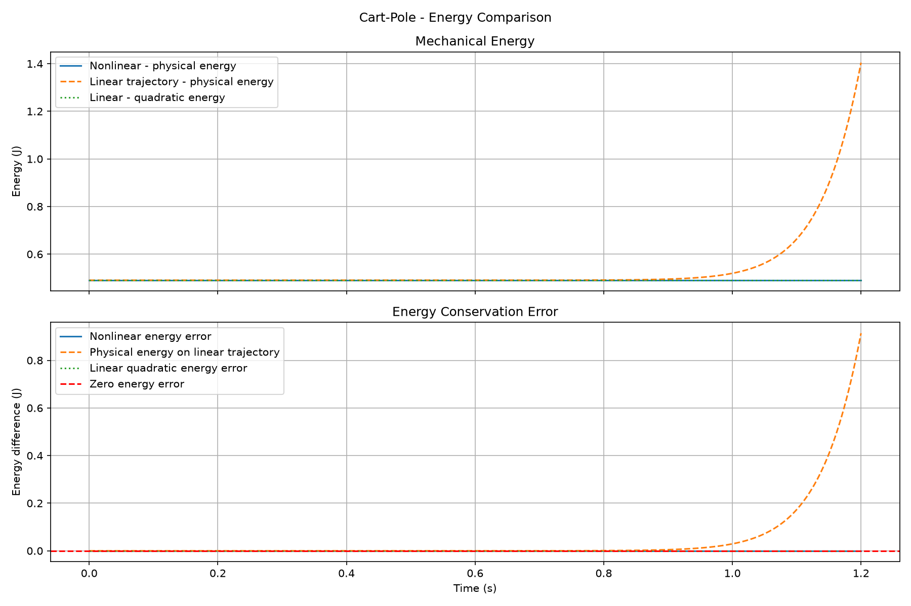
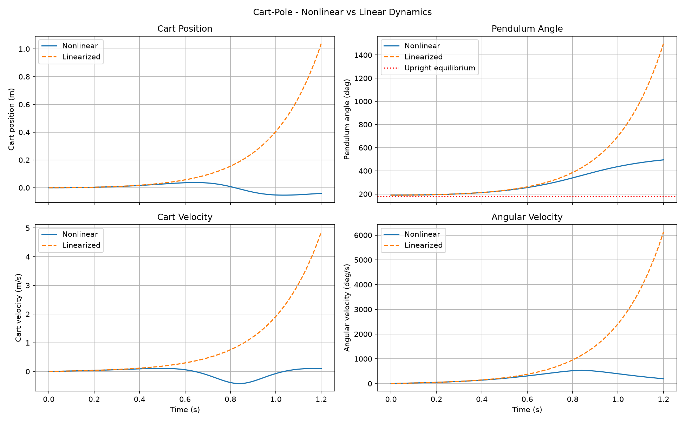
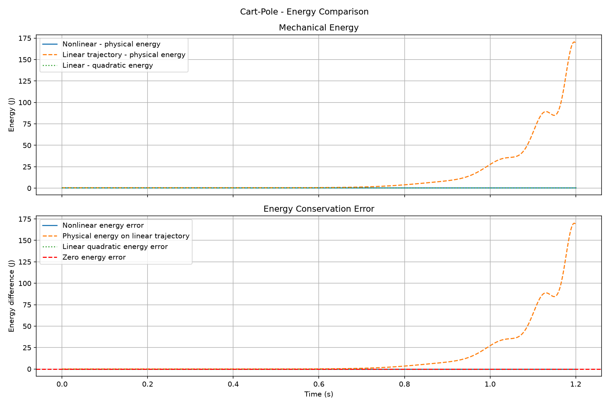

# 01 — Nonlinear vs Linear Dynamics

**Source:** [scripts/model_analysis/01_compare_dynamics.py](../../scripts/model_analysis/01_compare_dynamics.py)  
**Parameters:** [config/cartpole-parameters.yaml](../../config/cartpole-parameters.yaml)  
**Equilibrium:** upright, theta = pi  
**Input:** u = 0 N (open loop)  
**Interval:** 0 to 1.2 s  
**Integration:** SciPy solve_ivp, RK45, rtol=1e-10, atol=1e-12

These PNG plots are **generated from the committed Python script** for three initial angular deviations. They are reproducible exports of the experiment, rather than copies of desktop screenshots.

## 0-degree initial deviation





Both models should remain at the upright equilibrium, apart from floating-point noise in the nonlinear model.

## 1-degree initial deviation





The trajectories agree near the equilibrium and gradually separate as the unstable mode amplifies the perturbation.

## 10-degree initial deviation





The linear approximation rapidly departs from the nonlinear model, illustrating its local validity.

## Energy curves

- **Nonlinear physical energy:** the physical mechanical energy evaluated along the nonlinear trajectory; constant in the ideal, unforced model.
- **Linear quadratic energy:** the second-order Taylor approximation of mechanical energy around the upright equilibrium; conserved by the ideal linearized dynamics.
- **Physical energy on the linear trajectory:** the original nonlinear energy expression evaluated at states predicted by the linear model. It is *not* a conserved quantity for the linearized system and its growth is not an integration error.

The reported energy differences subtract each corresponding initial energy. The linear and nonlinear models are compared using identical physical initial conditions.

## Reproduce locally

From the repository root, with NumPy, SciPy, Matplotlib, and PyYAML installed:

```bash
for angle in 0 1 10; do
  MPLBACKEND=Agg CARTPOLE_INITIAL_ANGLE_DEG="$angle" CARTPOLE_PLOT_DIR="results/01_dynamics_comparison" python scripts/model_analysis/01_compare_dynamics.py
done
```

The export mechanism is also run by the GitHub Actions workflow [Export Experiment 01 Results](../../.github/workflows/export-experiment-01.yml). This workflow automatically commits generated plots on the default branch when relevant code or the workflow changes.
